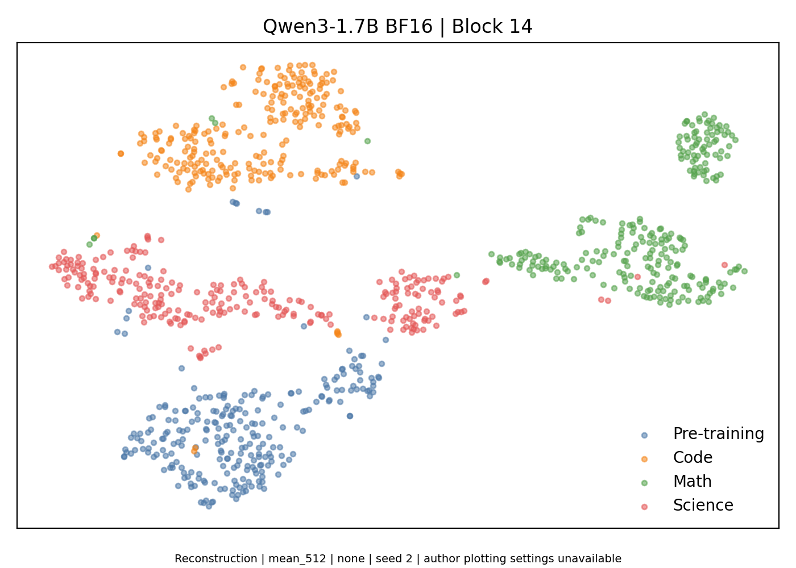
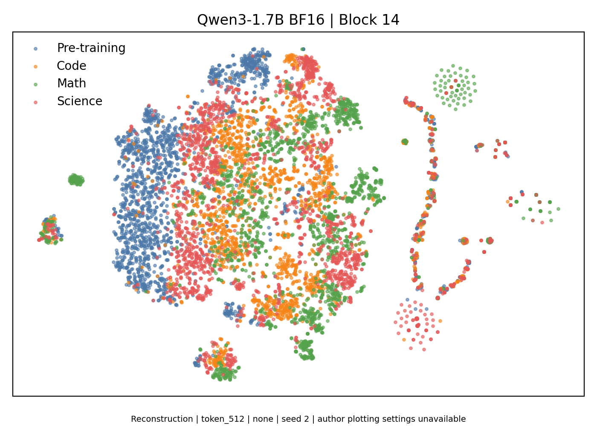

# Qwen3-1.7B：ReasoningQAT Fig. 2(b) 复现检查

运行已完成：四域各256条，总计1,024条；BF16 Qwen3-1.7B，第14个 Transformer block；28张图片及对应二维坐标。

**当前结论：前向和绘图流程跑通，但尚不能认定复现了论文“预训练输入紧凑、推理输入分散”的核心现象。** 预先指定的均值池化主图出现四域分离；逐 token 对照明显更混合。不要按视觉相似度选择种子。

[原论文 Fig. 2(b)](https://proceedings.iclr.cc/paper_files/paper/2026/file/209423f076b6479ab3a4f45886e30306-Paper-Conference.pdf)未完整公开 pooling、输入是否含回答、采样和降维参数。本次为记录假设的 reconstruction，非作者绘图脚本的精确复现。

主图高维域内离散度：Pre-training 1688.96、Code 965.30、Math 1698.09、Science 1998.76；预训练域不是最紧凑。[完整统计](statistics.json)。

## 预先指定的主图

512为最大截断长度，保留128–511 token的短样本；每点是一条输入的激活均值，无L2归一化，seed 2。

## 逐 token 对照

每条输入均匀抽取8个 token；同一输入的 token 相关，不应视为独立样本。

## 全部对照图

每个面板独立联合拟合四域的PCA/t-SNE，面板之间坐标轴不可直接比较。

| 表征 | 最大长度 | 归一化 | seed 2 | seed 3 | seed 42 |
|---|---:|---|---|---|---|
| mean | 128 | none | [图片](mean_128_none_seed2.png) | [图片](mean_128_none_seed3.png) | [图片](mean_128_none_seed42.png) |
| mean | 128 | l2 | [图片](mean_128_l2_seed2.png) | [图片](mean_128_l2_seed3.png) | [图片](mean_128_l2_seed42.png) |
| mean | 512 | none | [图片](mean_512_none_seed2.png) | [图片](mean_512_none_seed3.png) | [图片](mean_512_none_seed42.png) |
| mean | 512 | l2 | [图片](mean_512_l2_seed2.png) | [图片](mean_512_l2_seed3.png) | [图片](mean_512_l2_seed42.png) |
| last | 128 | none | [图片](last_128_none_seed2.png) | [图片](last_128_none_seed3.png) | [图片](last_128_none_seed42.png) |
| last | 128 | l2 | [图片](last_128_l2_seed2.png) | [图片](last_128_l2_seed3.png) | [图片](last_128_l2_seed42.png) |
| last | 512 | none | [图片](last_512_none_seed2.png) | [图片](last_512_none_seed3.png) | [图片](last_512_none_seed42.png) |
| last | 512 | l2 | [图片](last_512_l2_seed2.png) | [图片](last_512_l2_seed3.png) | [图片](last_512_l2_seed42.png) |
| token | 128 | none | [图片](token_128_none_seed2.png) | — | — |
| token | 128 | l2 | [图片](token_128_l2_seed2.png) | — | — |
| token | 512 | none | [图片](token_512_none_seed2.png) | — | — |
| token | 512 | l2 | [图片](token_512_l2_seed2.png) | — | — |

[完整方法与局限](METHOD.md) · [协议](protocol.json) · [提取和绘图代码](run.py) · [SHA256清单](artifact_inventory.json)

仅发布图片、二维坐标、代码和小型统计文件。模型权重、完整高维激活、原始语料和缓存留在本机。
