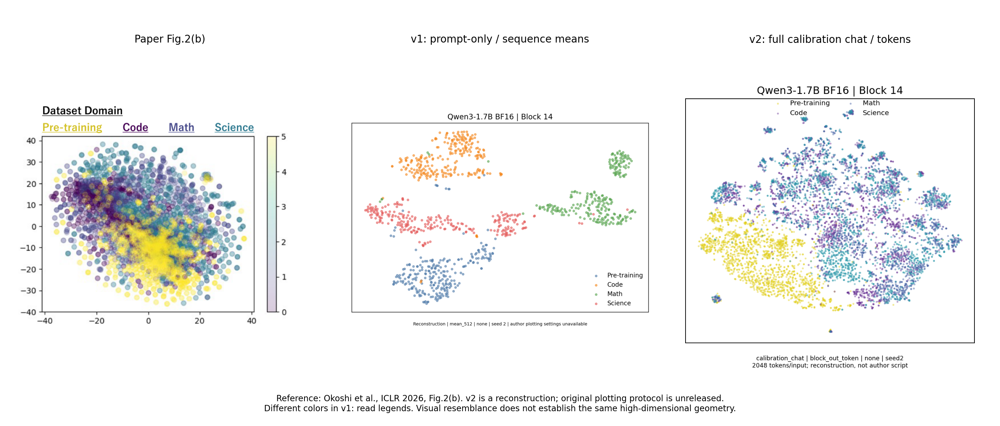
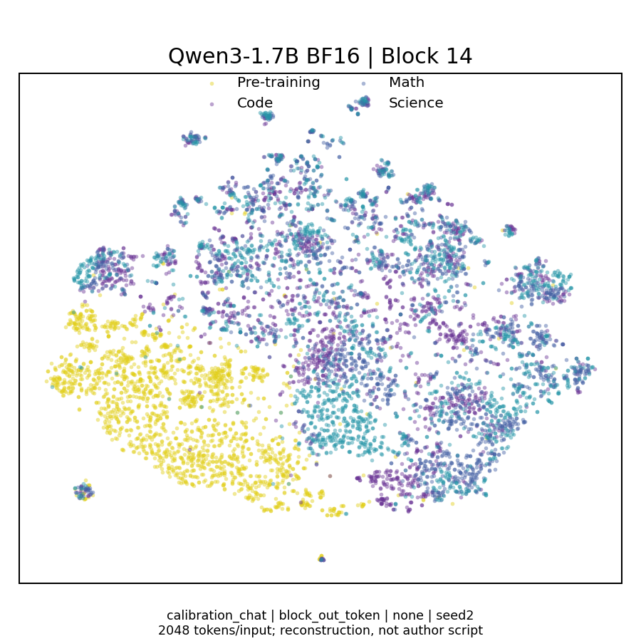
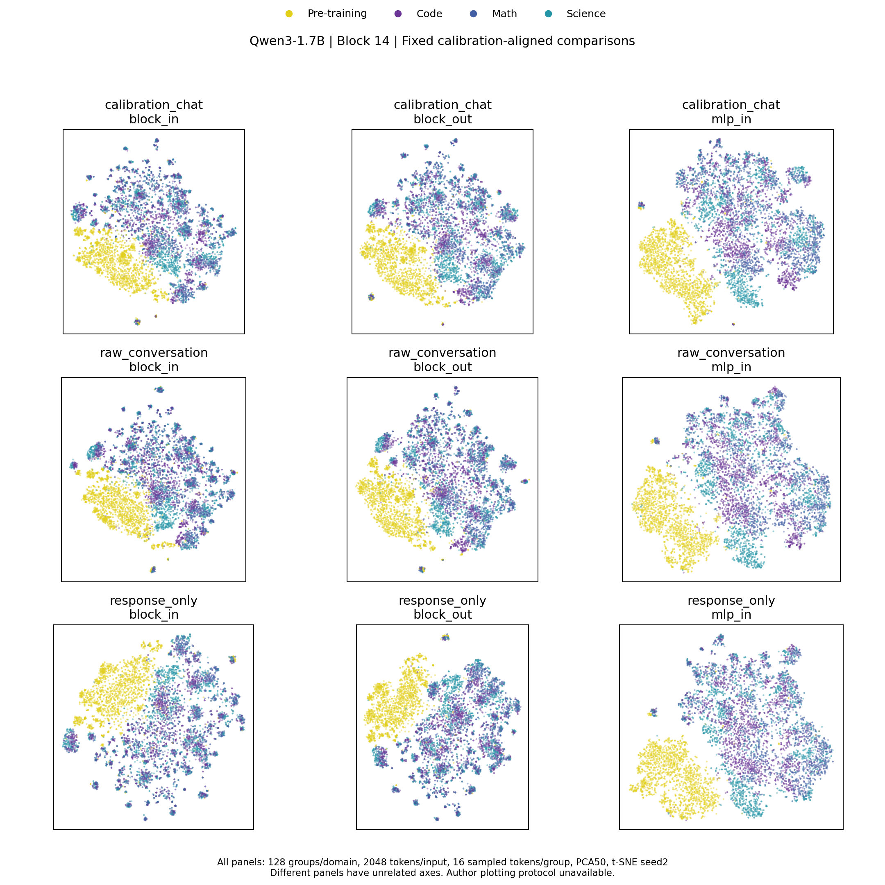

# ReasoningQAT Fig. 2(b)：修正版复现

**本轮完成。二维现象比v1更接近论文，但不声称精确复现或证实同样的高维几何。**

主要修正：使用完整问题与回答，按官方校准代码套用chat template；严格2048 token；由序列均值主图改为逐token主图；补充去模板问答、仅回答、三种激活位置和归一化对照。四域各128组，逐token主图每组随机抽取16个位置；固定第14层，不挑层或种子。

三个主图种子的二维“合并推理/预训练离散度”约为2.63、2.63、2.66；2048/4096点数对照也大于1。原始高维主配置却为0.659（按源组bootstrap95%CI：0.646–0.672）。说明二维外观不能直接推出原始空间中推理表征更分散。

[统计报告](RESULTS.md) · [方法与局限](METHOD.md) · [层位置验证](hook_validation.json) · [数据与特征验证](data_feature_validation.json) · [完整高维统计](pooled_dispersion.json)

## 原论文、v1与v2并排比较

原图来源：[Okoshi et al., ICLR 2026, Fig. 2(b)](https://proceedings.iclr.cc/paper_files/paper/2026/file/209423f076b6479ab3a4f45886e30306-Paper-Conference.pdf)。作者未完整公开绘图协议；原图作为署名比较参考保留。

## 预先指定主图

## 固定比较网格

三个输入视图×三个激活位置，均为逐token、无归一化、seed2。各面板独立拟合，坐标轴不能跨图直接比较。

## 全部56张固定配置图

| 输入 | 激活 | 汇总 | 无归一化 seed2 | L2 seed2 |
|---|---|---|---|---|
| calibration_chat | block_in | mean | [图片](plots/calibration_chat_block_in_mean_none_seed2.png) | [图片](plots/calibration_chat_block_in_mean_l2_seed2.png) |
| calibration_chat | block_in | token | [图片](plots/calibration_chat_block_in_token_none_seed2.png) | [图片](plots/calibration_chat_block_in_token_l2_seed2.png) |
| calibration_chat | block_in | last | [图片](plots/calibration_chat_block_in_last_none_seed2.png) | [图片](plots/calibration_chat_block_in_last_l2_seed2.png) |
| calibration_chat | block_out | mean | [图片](plots/calibration_chat_block_out_mean_none_seed2.png) | [图片](plots/calibration_chat_block_out_mean_l2_seed2.png) |
| calibration_chat | block_out | token | [图片](plots/calibration_chat_block_out_token_none_seed2.png) | [图片](plots/calibration_chat_block_out_token_l2_seed2.png) |
| calibration_chat | block_out | last | [图片](plots/calibration_chat_block_out_last_none_seed2.png) | [图片](plots/calibration_chat_block_out_last_l2_seed2.png) |
| calibration_chat | mlp_in | mean | [图片](plots/calibration_chat_mlp_in_mean_none_seed2.png) | [图片](plots/calibration_chat_mlp_in_mean_l2_seed2.png) |
| calibration_chat | mlp_in | token | [图片](plots/calibration_chat_mlp_in_token_none_seed2.png) | [图片](plots/calibration_chat_mlp_in_token_l2_seed2.png) |
| calibration_chat | mlp_in | last | [图片](plots/calibration_chat_mlp_in_last_none_seed2.png) | [图片](plots/calibration_chat_mlp_in_last_l2_seed2.png) |
| raw_conversation | block_in | mean | [图片](plots/raw_conversation_block_in_mean_none_seed2.png) | [图片](plots/raw_conversation_block_in_mean_l2_seed2.png) |
| raw_conversation | block_in | token | [图片](plots/raw_conversation_block_in_token_none_seed2.png) | [图片](plots/raw_conversation_block_in_token_l2_seed2.png) |
| raw_conversation | block_in | last | [图片](plots/raw_conversation_block_in_last_none_seed2.png) | [图片](plots/raw_conversation_block_in_last_l2_seed2.png) |
| raw_conversation | block_out | mean | [图片](plots/raw_conversation_block_out_mean_none_seed2.png) | [图片](plots/raw_conversation_block_out_mean_l2_seed2.png) |
| raw_conversation | block_out | token | [图片](plots/raw_conversation_block_out_token_none_seed2.png) | [图片](plots/raw_conversation_block_out_token_l2_seed2.png) |
| raw_conversation | block_out | last | [图片](plots/raw_conversation_block_out_last_none_seed2.png) | [图片](plots/raw_conversation_block_out_last_l2_seed2.png) |
| raw_conversation | mlp_in | mean | [图片](plots/raw_conversation_mlp_in_mean_none_seed2.png) | [图片](plots/raw_conversation_mlp_in_mean_l2_seed2.png) |
| raw_conversation | mlp_in | token | [图片](plots/raw_conversation_mlp_in_token_none_seed2.png) | [图片](plots/raw_conversation_mlp_in_token_l2_seed2.png) |
| raw_conversation | mlp_in | last | [图片](plots/raw_conversation_mlp_in_last_none_seed2.png) | [图片](plots/raw_conversation_mlp_in_last_l2_seed2.png) |
| response_only | block_in | mean | [图片](plots/response_only_block_in_mean_none_seed2.png) | [图片](plots/response_only_block_in_mean_l2_seed2.png) |
| response_only | block_in | token | [图片](plots/response_only_block_in_token_none_seed2.png) | [图片](plots/response_only_block_in_token_l2_seed2.png) |
| response_only | block_in | last | [图片](plots/response_only_block_in_last_none_seed2.png) | [图片](plots/response_only_block_in_last_l2_seed2.png) |
| response_only | block_out | mean | [图片](plots/response_only_block_out_mean_none_seed2.png) | [图片](plots/response_only_block_out_mean_l2_seed2.png) |
| response_only | block_out | token | [图片](plots/response_only_block_out_token_none_seed2.png) | [图片](plots/response_only_block_out_token_l2_seed2.png) |
| response_only | block_out | last | [图片](plots/response_only_block_out_last_none_seed2.png) | [图片](plots/response_only_block_out_last_l2_seed2.png) |
| response_only | mlp_in | mean | [图片](plots/response_only_mlp_in_mean_none_seed2.png) | [图片](plots/response_only_mlp_in_mean_l2_seed2.png) |
| response_only | mlp_in | token | [图片](plots/response_only_mlp_in_token_none_seed2.png) | [图片](plots/response_only_mlp_in_token_l2_seed2.png) |
| response_only | mlp_in | last | [图片](plots/response_only_mlp_in_last_none_seed2.png) | [图片](plots/response_only_mlp_in_last_l2_seed2.png) |

主配置随机种子：[seed2](plots/calibration_chat_block_out_token_none_seed2.png) · [seed3](plots/calibration_chat_block_out_token_none_seed3.png) · [seed42](plots/calibration_chat_block_out_token_none_seed42.png)。

## 点数敏感性对照

主图8192点保持不变。以下来自相同源组的预先采样token子集，不能按相似程度替换主图。

- [calibration_chat_block_out_2048points_seed2](point_count_controls/calibration_chat_block_out_2048points_seed2.png)
- [calibration_chat_block_out_2048points_seed3](point_count_controls/calibration_chat_block_out_2048points_seed3.png)
- [calibration_chat_block_out_2048points_seed42](point_count_controls/calibration_chat_block_out_2048points_seed42.png)
- [calibration_chat_block_out_4096points_seed2](point_count_controls/calibration_chat_block_out_4096points_seed2.png)

## 验证与边界

第14层hook与完整模型hidden_states索引13/14一致；缩短至14层执行时与完整28层前向完全一致。全部特征有限、形状正确；三个输入对照的FineWeb基线前向完全一致。采样来自多个随机分片，但不是官方全语料shuffle；长回答筛选及FineWeb顺序采样仍有偏差。token在同一源组内相关。

本轮约20.4分钟；GPU3检索优先，正式实验代码、配置、结果未改动。全部旧图保留。仅上传图片、二维坐标、代码及统计，未上传模型权重、完整高维特征、原始文本或token输入。代码按本机workspace根目录布局运行；发布目录本身不是独立环境安装包。

[SHA256文件清单](artifact_inventory.json)。
