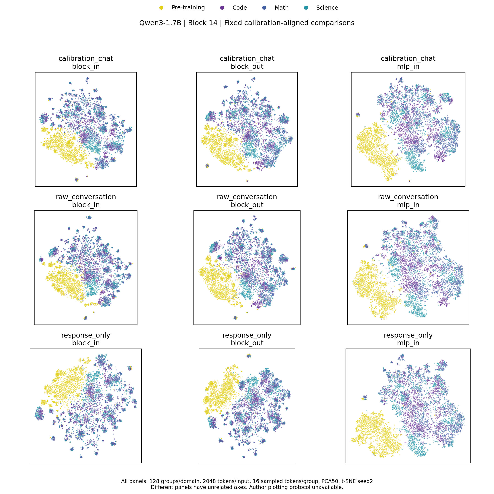
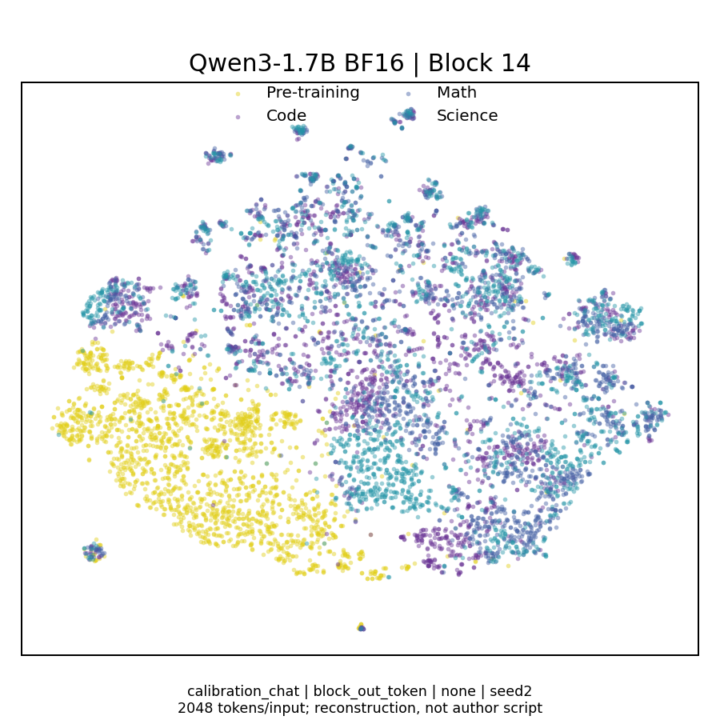

# 修正版结果：完整问答、固定2048 token

固定第14层，128组/域；已验证 hook 位置及14层截断与完整前向一致。主图预先指定，无挑选层或随机种子。

域内方差与“将三个推理域合并后的总体方差”不是同一个指标。以下同时报告两者；后者也包含推理域之间的均值差异，不能单独推断每一域内部都更分散。

## 固定主表：逐token、无归一化

| 输入 | 位置 | 推理合并/预训练离散度 | Code/预训练 | Math/预训练 | Science/预训练 |
|---|---|---:|---:|---:|---:|
| calibration_chat | block_in_token | 0.629 | 0.622 | 0.568 | 0.670 |
| calibration_chat | block_out_token | 0.659 | 0.654 | 0.604 | 0.694 |
| calibration_chat | mlp_in_token | 0.808 | 0.810 | 0.758 | 0.807 |
| raw_conversation | block_in_token | 0.618 | 0.610 | 0.551 | 0.668 |
| raw_conversation | block_out_token | 0.646 | 0.640 | 0.586 | 0.687 |
| raw_conversation | mlp_in_token | 0.810 | 0.809 | 0.760 | 0.811 |
| response_only | block_in_token | 0.581 | 0.531 | 0.546 | 0.646 |
| response_only | block_out_token | 0.607 | 0.557 | 0.581 | 0.664 |
| response_only | mlp_in_token | 0.760 | 0.703 | 0.755 | 0.782 |

主图合并推理/预训练离散度的按源组 bootstrap 95% CI：[0.6455641210597619, 0.6721322889924694]

局限：Fig2b的原始绘图脚本未公开；沿用官方校准输入构造不等于已知原图就是该构造。推理样本为长回答子集，FineWeb仍按顺序采样。t-SNE不能保留所有全局距离，图形相似不等于科学结论复现。统计区间仅反映当前样本组的重采样，不包含语料来源选择不确定性。

[全部高维统计](pooled_dispersion.json) · [旧版合并推理指标重分析](v1_pooled_reanalysis.json) · [层位置验证](hook_validation.json)
