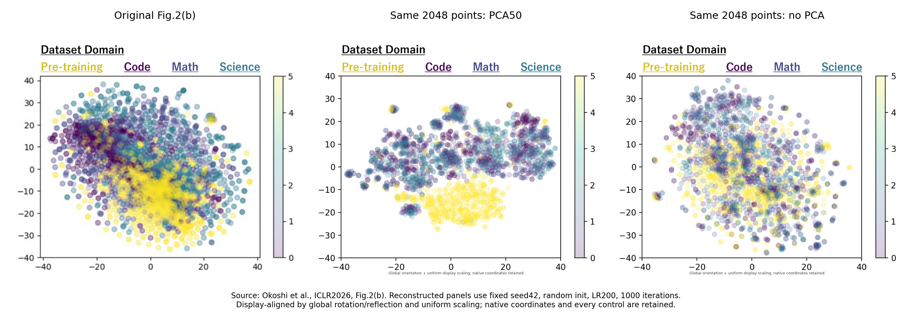
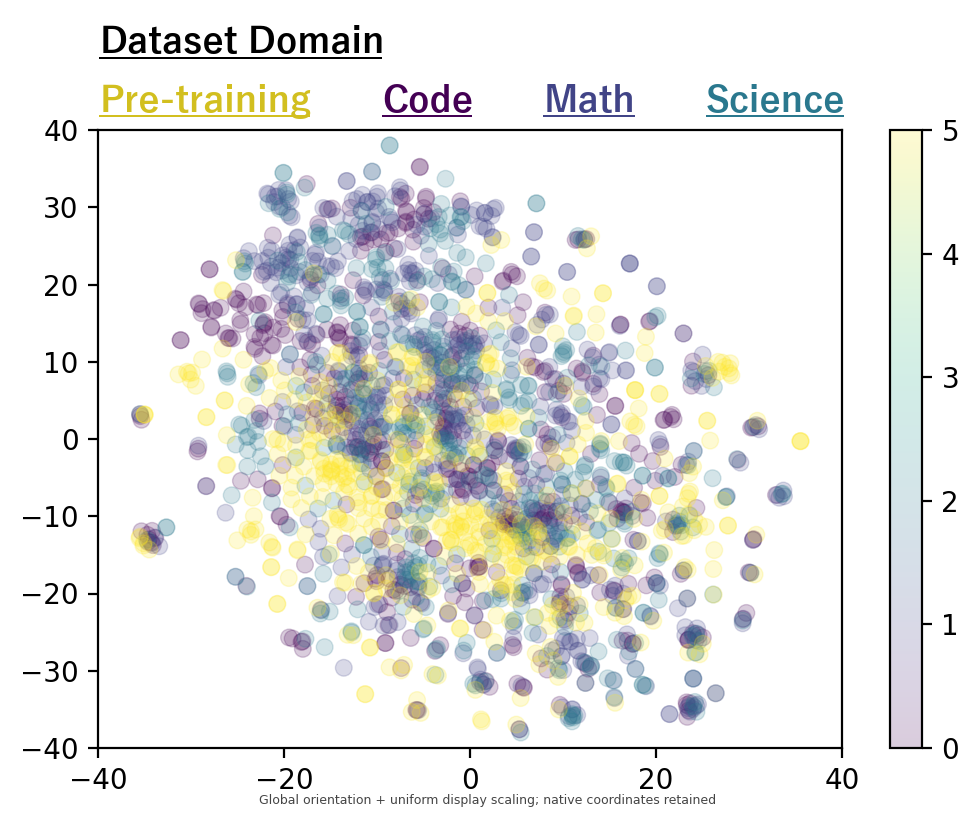
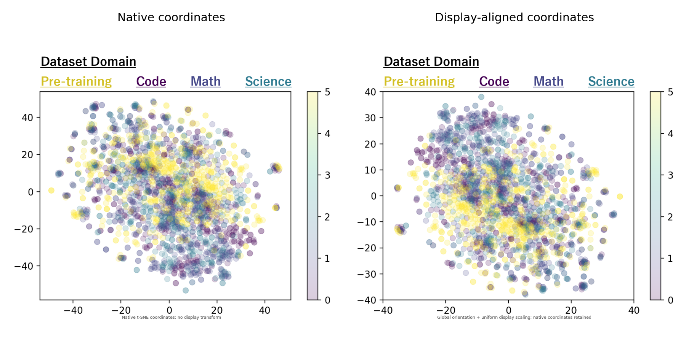

# Fig.2(b)：PCA诊断与原图版式对齐

本轮完成：10组固定参数对照、3组无PCA种子/迭代检查；另保留v2主图及原始坐标、未旋转对照。**无PCA的版本在二维外观上更接近原图，但仍不是作者精确配置的确认复现。**

## 原图、相同点的PCA与无PCA比较

中、右两图使用完全相同的2048个token向量、seed42、random初始化、学习率200、1000次迭代，只改变是否先PCA50。展示方向与比例另作全局对齐，详细说明见下文。图形相似不能证明作者就是采用这组参数。

## 重点查看：不先做PCA的历史默认参数对照

[PNG纯图](paper_style/pcaNone_initrandom_lr200_perp30.png) · [PDF](paper_style/pcaNone_initrandom_lr200_perp30.pdf) · [SVG](paper_style/pcaNone_initrandom_lr200_perp30.svg)

该参数组在探索前已列入固定对照，没有通过挑种子或移动某个域来匹配原图。它是可检查的候选重建，不替代此前预先指定的v2主配置及全部历史结果。

## 发现的实质问题

PCA50仅保留当前点集方差的 **36.5%**，与原始空间15近邻的平均重合为 **35.4%**。因此它不是无影响的绘图步骤，可能明显改变t-SNE所拟合的邻域。本轮优先检查无PCA，是依据这个诊断，不是只依据外观。

同一2048点原始高维合并推理/预训练离散度为0.673，PCA50后为0.756，均小于1。二维图的排序不能外推为高维空间中的同样排序。

## 已对齐的版式与其证据

- 顶部`Dataset Domain`及`Pre-training / Code / Math / Science`：直接读取原PDF的文字原点、字号、RGB、下划线矩形；本机从PDF嵌入子集字体恢复Unicode映射，以原YuGothic-Bold字形重绘。字体二进制不上传。
- 横轴−40..40、步长20；纵轴−40..40、步长10；主轴与色条的长宽及间距按嵌入图488×357像素测量。
- 右侧连续Viridis色条0..5；由原JPEG内颜色拟合出的透明度约0.201，RGB拟合RMSE低于1/255量级（数值为约0.99个8bit灰阶）。
- 为复刻可见配色，推断Code=0、Math=1、Science=2、Pre-training=5。**这是绘图编码假设，不是论文确认的编号定义，更不是熵、概率或激活强度。** 3/4只在我们的映射中未使用，不能据此推断作者没有其他编号。
- 散点透明度0.2由色条联动推断，尺寸36为默认尺寸假设；作者原始散点参数仍未知。

## 坐标和位置的对齐方式

为了把预训练域展示在下方、Code展示在Science左侧，展示版只施加**一套作用于所有点的正交旋转/镜像**，再居中并作**同一个等比例缩放**以完整放入−40..40。Math等其他域不单独定位。成对距离按同一比例保持，且没有裁掉数据点。它是有类别锚点的版式处理，不是原始坐标或独立复现的证据。

每幅图对应的NPZ同时保存`native_xy`、`display_xy`和标签；JSON记录矩阵、平移、缩放、随机成对距离校验和裁切计数。需要做科学距离统计时使用原始特征/坐标，不能把显示坐标当作原始t-SNE数值。各图独立归一化显示，不应跨图比较坐标绝对大小。

## 全部10组固定参数对照

均为相同2048点，seed42，1000次迭代；每幅有PNG、PDF、SVG，且不按外观相似度隐藏其他结果。

| PCA | 初始化 | LR | perplexity | KL | 二维推理/预训练离散度 | 图片 |
|---|---|---|---:|---:|---:|---|
| None | pca | auto | 30 | 2.106 | 1.481 | [图片](paper_style/pcaNone_initpca_lrauto_perp30_annotated.png) |
| None | pca | 200 | 30 | 2.160 | 1.307 | [图片](paper_style/pcaNone_initpca_lr200_perp30_annotated.png) |
| None | random | auto | 30 | 2.141 | 1.340 | [图片](paper_style/pcaNone_initrandom_lrauto_perp30_annotated.png) |
| None | random | 200 | 30 | 2.148 | 1.369 | [图片](paper_style/pcaNone_initrandom_lr200_perp30_annotated.png) |
| 50 | pca | auto | 30 | 1.507 | 2.337 | [图片](paper_style/pca50_initpca_lrauto_perp30_annotated.png) |
| 50 | pca | 200 | 30 | 1.498 | 2.173 | [图片](paper_style/pca50_initpca_lr200_perp30_annotated.png) |
| 50 | random | auto | 30 | 1.490 | 2.778 | [图片](paper_style/pca50_initrandom_lrauto_perp30_annotated.png) |
| 50 | random | 200 | 30 | 1.506 | 2.211 | [图片](paper_style/pca50_initrandom_lr200_perp30_annotated.png) |
| None | random | 200 | 100 | 1.729 | 1.300 | [图片](paper_style/pcaNone_initrandom_lr200_perp100_annotated.png) |
| 50 | pca | auto | 100 | 1.216 | 2.364 | [图片](paper_style/pca50_initpca_lrauto_perp100_annotated.png) |

不同PCA输入对应不同邻域图，其KL不能作为共同准确性评分来选胜者。

## 无PCA稳定性检查

| seed | 迭代 | KL | 二维推理/预训练离散度 | 图片 |
|---:|---:|---:|---:|---|
| 2 | 1000 | 2.138 | 1.345 | [图片](paper_style/nopca_random_lr200_seed2_iter1000_annotated.png) |
| 3 | 1000 | 2.126 | 1.241 | [图片](paper_style/nopca_random_lr200_seed3_iter1000_annotated.png) |
| 42 | 3000 | 2.125 | 1.396 | [图片](paper_style/nopca_random_lr200_seed42_iter3000_annotated.png) |

## 基础模型与官方源码核对

本机权重两个分片、config、generation_config、tokenizer配置及tokenizer内容均与官方匹配。tokenizer.json为LFS内容，应核对LFS SHA256，不能把Git指针blob哈希与文件内容哈希混淆。[模型审计](base_model_audit.json)。

官方当前主分支17个Python文件无t-SNE关键字；两个可见历史版本文件路径也未发现绘图脚本。[内容审计](official_keyword_audit.json) · [历史审计](official_history_audit.json)。OpenReview附件API返回403，未声称已穷尽不可访问附件。

## 为什么仍不能保证逐点精确复现

仍缺作者的样本ID/数据版本、选取的token位置、块内激活张量定义、是否池化/标准化，以及t-SNE库版本和全部参数。仅凭原图不能反推出唯一解。色条编号、散点尺寸和透明度也尚非作者代码确认。

[需要作者确认的最小信息](AUTHOR_QUESTIONS.md) · [版式验证](exact_style_validation.json) · [原图审计](reference_audit.json) · [原始t-SNE坐标及变换](coordinates/) · [PCA邻域审计](pca_neighborhood_audit.json)。

本轮所有计算仅CPU，复用已有激活；检索GPU、正式实验代码/环境/权重/结果均未改动。

来源：[论文Fig.2(b)](https://proceedings.iclr.cc/paper_files/paper/2026/file/209423f076b6479ab3a4f45886e30306-Paper-Conference.pdf)、[官方仓库](https://github.com/yasu0001/ReasoningQAT)、[sklearn t-SNE参数文档](https://scikit-learn.org/stable/modules/generated/sklearn.manifold.TSNE.html)。

运行脚本需要本机v2输入/高维特征与原论文PDF；本次没有上传这些大文件。发布的`coordinates/`对应运行目录中的`panels/`。字体通过原PDF本地提取并恢复字符映射，未发布字体二进制。

[全部发布文件SHA256清单](artifact_inventory.json)。
